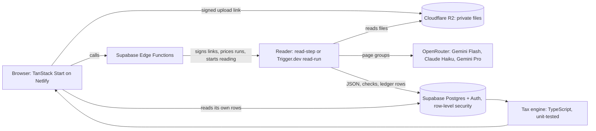

# Deliverable 3: Architecture notes

Part of Deliverable 3 with [`spec.md`](../spec.md). Author: marvin-mvm. The same architecture is
on the deck slides "Deliverable 3" at <https://takatax.netlify.app/deck>.

**Principle: AI reads, code computes.** The models only read documents. A rules engine does the
tax math, so every number can be reproduced and explained.

## System diagram

## Layers

| Layer              | Technology                                                                              | Responsibility                                                                                                                                                                                                                                   |
| ------------------ | --------------------------------------------------------------------------------------- | ------------------------------------------------------------------------------------------------------------------------------------------------------------------------------------------------------------------------------------------------ |
| UI                 | TanStack Start (React 19, Vite), Tailwind CSS 4, shadcn/ui, Recharts; hosted on Netlify | Upload with page counting and photo checks, progress bars, documents, "Please check" form, tracker and return figures, invitations, chat, community                                                                                              |
| Backend            | Supabase Edge Functions (Deno, TypeScript)                                              | `create-upload-urls`, `confirm-upload`, `create-checkout` (prices runs; payments off at launch), `read-documents` (starts the reader, read-once), `read-step` (reader), `document-link`, `assistant-chat`, `delete-document`, `payments-webhook` |
| AI layer           | OpenRouter, server-side only                                                            | The three-model reader, the COR reader and the records assistant; strict JSON schema; cost of every call logged                                                                                                                                  |
| Background reading | `read-step` (Supabase, live today) or the Trigger.dev job `read-run`                    | Reads each photo, and each PDF a few pages at a time, with retries and saved progress, so long PDFs never hit a function's time limit. The `READER` secret chooses                                                                               |
| Data               | Supabase Postgres and Auth                                                              | Accounts, documents, ledger, runs, invitations, activity log, chat, community. Row-level security on every table; access rules in SQL functions                                                                                                  |
| Files              | Cloudflare R2                                                                           | Private bucket; the browser uploads with short-lived signed links; no download fees                                                                                                                                                              |
| Tax engine         | Plain TypeScript in `supabase/functions/_shared/domain/`                                | 1701Q, 2551Q, SAWT and deadlines; shared by the app and the functions; unit-tested                                                                                                                                                               |

## Data flow: from a photo to a return figure

1. The user picks photos or PDFs. The browser checks each photo, counts PDF pages and shows the
   price before anything is uploaded.
2. `create-upload-urls` checks the files and the account's storage, creates the document rows and
   returns signed links; the browser uploads each file straight to R2.
3. `confirm-upload` checks each file arrived; `create-checkout` prices the run (free at launch);
   `read-documents` claims the documents in one update (read once) and starts the reader.
4. The reader sends each photo, or up to 5 PDF pages, to the fast model; checks the JSON and the
   arithmetic; escalates to the second and top models when unsure; saves pages done for the
   progress bars.
5. Each read document becomes ledger rows; unsure ones are "Please check" for the user.
6. The tax engine computes the return figures and deadlines from the ledger and the confirmed COR.

## Security

- **No secrets in the repo or the browser.** The browser only has the public Supabase URL and
  publishable key. The OpenRouter and R2 keys are Supabase Edge Function secrets (and Trigger.dev
  variables); every commit was scanned for keys before the repository went public.
- **Row-level security on every table**, tested with SQL behaviour checks: a user sees only their
  account; a professional sees a client only after accepting an invitation, and never its
  payments; an unchangeable activity log records what professionals open and change.
- **Every edge function checks who is calling and what it was sent** (types, sizes, counts);
  forms are validated with Zod.
- **Cost guards:** pages priced before reading, read-once, a daily AI spending cap.

## Deployment and CI/CD

- GitHub Actions `ci.yml`: lint, type-check, 418 unit tests and a production build on every pull
  request and push. `trigger-deploy.yml` deploys the background reader.
- Netlify deploys `main` to <https://takatax.netlify.app>. Work happens on a build branch and
  reaches `main` through reviewed pull requests.
- Monitoring: the `ai_spend` log and daily cap, Supabase function logs, Netlify deploy logs and
  CI status.
